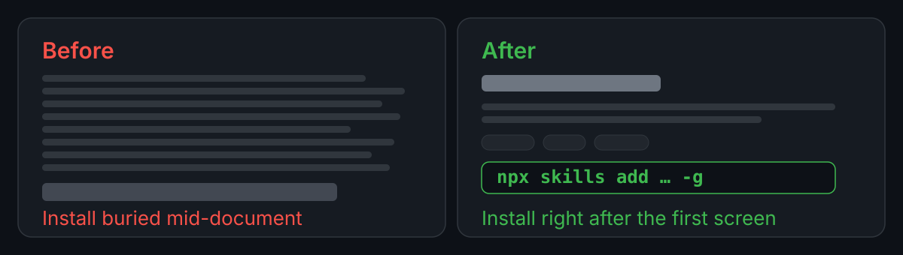

# README Skill

[](https://github.com/hnyxgxm/github-readme-skill/actions/workflows/check.yml) [](LICENSE) [](https://nodejs.org/)

[简体中文](README.md) · English

A skill that makes AI coding assistants decide how much a README should carry, then turn a project's real capabilities into a front page a stranger can judge and start using. It governs triage and evidence, not prose polish.

[Install](#install) · [Quick start](#quick-start) · [Examples](#examples) · [Features](#features)



Judgement is half of it; the mechanical half runs as scripts. Below is the real check output for the previous version of this README ([5bb1748](https://github.com/hnyxgxm/github-readme-skill/blob/5bb1748/README.en.md)), reproduced verbatim: the tool prints in Chinese, so the output stays Chinese.

```text
README.md: 126 行, H1 1, H2 8, 徽章 1, 图 1, 首屏 10 行
! WARN 第 11 行 — 二级标题「它改出来的样子」用了口头语
! WARN 第 29 行 — 二级标题「它解决什么」用了口头语
! WARN 第 54 行 — 提到 Node.js 22.20，仓库里找不到对应依据
```

## Install

This is an instruction and reference package for coding assistants, not standalone software. The README exists in Chinese and English; **the skill instructions and reference files are currently Chinese only**. To see what it will tell an assistant to do, read [SKILL.md](SKILL.md) and `references/` directly.

All three clients share one `skills` CLI command and install the same complete package. It needs **Node.js 22.20+** — that is the `engines` requirement of the `skills` package, not a dependency of this repository (source: `package.json` of `skills@1.7.6`, value `>=22.20.0`). Run this in any directory:

```sh
npx skills add hnyxgxm/github-readme-skill -g
```

Pick clients when prompted, or specify them with `-a`. `-g` installs at user level for all projects; drop `-g` inside a target project to install only there.

- **Claude Code** (`-a claude-code`): `~/.claude/skills/`; type `/` in a new session and choose `github-readme-skill`
- **Codex** (`-a codex`): `~/.agents/skills/`; type `$github-readme-skill` in a new session
- **Qoder Desktop** (`-a qoder`): `~/.qoder/skills/`; type `/` in a new task and choose `github-readme-skill`

Start a new session afterwards and confirm the skill appears in the picker. If it does not, check that the directory contains `SKILL.md` and `references/`, that the path matches the list above, then restart the client. Installing writes into a skills directory, so if a skill with the same name already exists, check its source first.

Fallback without Node.js: copy the whole repository directory (including `references/`) into any of the skill directories above, then restart the client. Cursor, OpenCode and Gemini CLI use the same command with their own target names, listed in the [supported agents file](https://github.com/vercel-labs/skills/blob/main/docs/agents.md); the installer supporting a client does not mean this skill has been verified there.

Maintenance: `npx skills update github-readme-skill -g` to update, `npx skills remove github-readme-skill -g` to uninstall; with several clients installed you are prompted to choose, or pass `-a`.

## Quick start

Select the skill in an existing project, point it at the repository or current README, then send:

```text
Use github-readme-skill to review and rewrite this repository's README.
Decide first whether it should be a router page or a manual, and propose a structure before writing.
Treat the current code and release artifacts as the only facts; omit anything you cannot verify.
Both languages, local edits only — do not commit or push.
```

The first response should be a form judgement and a structure, not a finished page. A delivery should name its primary evidence, what was moved off the front page, which directory each command runs in, and which facts remain unverified.

Add "review only, don't touch the files" to skip edits; scope a fix to one section when only that section is broken.

## Examples

The input here is the previous version of this README: same repository, same facts, only the organisation changed. Both versions are in the commit history behind fixed links, so every row below can be counted:

[before 5bb1748](https://github.com/hnyxgxm/github-readme-skill/blob/5bb1748/README.en.md) → [after 7c9648e](https://github.com/hnyxgxm/github-readme-skill/blob/7c9648e/README.en.md)

| Item | Before | After |
| --- | --- | --- |
| First screen | one positioning line + four anchors, the first section being "what it produced" | one positioning line + three badges + one before/after image |
| Install | line 57, the fourth H2, with 47 lines above it | line 22, the first H2 |
| Badges | 1 (CI only) | 3 (CI, MIT licence, Node version) |
| Images | 0 | 1 |
| H2 sections | 8, three of them full sentences ("what it produced", "what it fixes", "how it works") | 7, all short headings, none of them a sentence |
| Whole page | 126 lines | 120 lines |

Line numbers, section counts and line counts are taken from the two fixed commits above. This README keeps changing, so no "current" numbers are given here — open the file and count if you need them.

The old version was not badly written; it was badly ordered. The thing a reader wants most — how to install — sat behind 47 lines that first explained what had been rewritten, what it fixes and how it works. The rewrite moved install to the first H2 and pushed the evidence below it.

## Features

Start with the practice it replaces; the difference is not in the prose:

- **Before:** open an editor and write from the title down, wherever the writing goes; skim two similar repositories for a structure; add badges, drop in a screenshot, end with "stars welcome". It ships, nobody uses it, and you cannot tell which part was wrong.
- **Now:** ask "besides this README, does the reader have somewhere else to go" to fix the form and length; verify every promise and version number against the repository; then run two scripts that block anchor, image and front-screen problems before release.

Concretely, it covers five things:

- **Copying a docs site, or leaving readers nowhere to go**: pick one of three forms (router page, middle state, manual), which decides how much the README carries. A repo with a `docs/` directory the README never links to is a middle state, not a manual.
- **An overloaded first screen**: the top of the page gets exactly four things — identity, one positioning sentence, trust markers, first result — in roughly 25 lines.
- **Adjectives standing in for evidence**: the primary proof follows the deliverable — a benchmark table or terminal output for a CLI, a real before/after for an Agent Skill, a minimal call for a library. No screenshots invented to fill space.
- **A difference nobody can name**: write "why use it" as a comparison of two practices, not as "faster, more elegant"; put numbers in an environment and mark anything unverified as unverified.
- **Installation split into five sections**: every client shares one `npx skills` command, and differences land only in target name, directory and how it is enabled; the same client never gets two parallel channels.

## Use cases

Built for projects with real code and a release, heading public — especially personal tools, internal CLIs and Agent Skills with no docs site. For those it defaults to manual, so it will not push you towards a docs site that does not exist.

Do not use it when:

- **You only need a typo or a badge fixed.** Just do it. This is a structural review; re-flowing the whole page for two lines is a bad trade.
- **You need a full API reference.** That belongs in a docs site or `docs/`; a README is the entrance.
- **You only dislike the tone.** It does not touch tone — that is the project's own voice, and rules would flatten every README into one.
- **There are no verifiable facts yet.** It will keep asking; with nothing to answer, all that is left is structure. Build the thing first.

Other limits:

- It supplies judgement and a checklist; it does not guarantee any model produces a good front page on the first pass. Output still depends on the model, the repository facts you provide and whether you check the result item by item.
- It will not choose a license, a distribution channel or a push moment for you. Writing docs is not authorization to commit, push, deploy or install extensions.
- README rendering is constrained by the platform: GitHub strips scripts and inline CSS, cannot produce horizontal tabs, and gives Markdown no layout containers. Anything important must read at normal width and at roughly 390px.
- This skill's frontmatter declares `allowed-tools`. Per the [skills compatibility table](https://github.com/vercel-labs/skills/blob/main/docs/agents.md), Qoder, Kiro CLI and Zencoder do not support that field — there it is ignored and tool permissions follow the client's own rules; Claude Code and Codex will honour it.

## Development

The judging method, the seven skeletons, the examples, the acceptance checks and the drawing rules all live in [SKILL.md](SKILL.md) and `references/`; read [Maintenance and regression](references/maintenance.md) before changing the skill itself.

Both scripts use nothing but the Python 3 standard library (3.8 or newer) and ship with `--selftest`; column width is overridable with `--column-width`, and `check-assets.py --check-remote` also verifies that external links resolve. Inside this repository:

```sh
python3 scripts/check-assets.py README.md
python3 scripts/check-text.py README.md README.en.md --pair --terms references/terms.txt
```

Once installed as a skill, the working directory is someone else's repository while the scripts and word list stay in the skill directory, so they must be called by absolute path or they will not be found:

```sh
SKILL=~/.claude/skills/github-readme-skill
python3 "$SKILL/scripts/check-assets.py" README.md
python3 "$SKILL/scripts/check-text.py" README.md README.en.md --pair --terms "$SKILL/references/terms.txt"
```

Exit code 0 means nothing will break; 1 means something must be fixed. Every finding is labelled as measured here, a platform limit, or an engineering threshold. The scripts only decide the mechanical half — a green badge says that half passed, nothing about whether the writing is any good.

## License

Released under the [MIT License](LICENSE): commercial and non-commercial use, modification and redistribution are permitted, provided the copyright and permission notices are kept in copies. Author: hnyxgxm.
