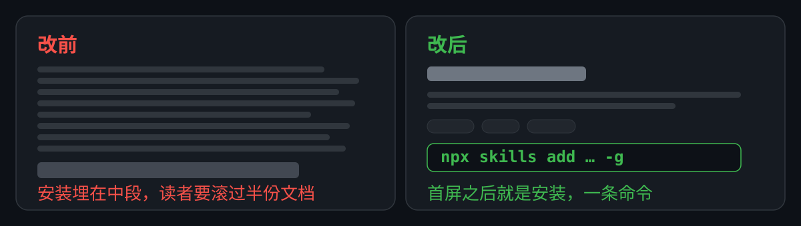

# README Skill

[](https://github.com/hnyxgxm/github-readme-skill/actions/workflows/check.yml) [](LICENSE) [](https://nodejs.org/)

[English](README.en.md) · 简体中文

让 AI 编程助手先判断一份 README 该承担多少内容，再把项目的真实能力组织成陌生读者能判断、能上手的首页。它管取舍和证据，不管辞藻。

[安装](#安装) · [快速开始](#快速开始) · [示例](#示例) · [功能](#功能)



判断之外，机械那一半有脚本兜底。下面是这份 README 改前版本（[5bb1748](https://github.com/hnyxgxm/github-readme-skill/blob/5bb1748/README.md)）的真实检查输出，点开 commit 可以自己复现：

```text
README.md: 126 行, H1 1, H2 8, 徽章 1, 图 1, 首屏 10 行
! WARN 第 11 行 — 二级标题「它改出来的样子」用了口头语
! WARN 第 29 行 — 二级标题「它解决什么」用了口头语
! WARN 第 54 行 — 提到 Node.js 22.20，仓库里找不到对应依据
```

## 安装

这是给编程助手读取的指令与参考资料包，不是独立软件。README 有中英两版，**技能指令与参考资料目前只有中文**。想先看清楚它会做什么，直接读 [SKILL.md](SKILL.md) 和 `references/`。

三个客户端共用一条 `skills` CLI 命令，装的是同一个完整技能包。需要 **Node.js 22.20+**——这是 `skills` 包 `engines` 字段的要求，不是本仓库的依赖（出处：`skills@1.7.6` 的 `package.json`，值 `>=22.20.0`）。在终端任意目录运行：

```sh
npx skills add hnyxgxm/github-readme-skill -g
```

按提示选择客户端，或用 `-a` 指定。`-g` 是用户级安装，所有项目可用；在目标项目目录去掉 `-g` 则只装到该项目。

- **Claude Code**（`-a claude-code`）：`~/.claude/skills/`；新会话输入 `/` 选择 `github-readme-skill`
- **Codex**（`-a codex`）：`~/.agents/skills/`；新会话输入 `$github-readme-skill`
- **Qoder Desktop**（`-a qoder`）：`~/.qoder/skills/`；新任务输入 `/` 选择 `github-readme-skill`

装好后开启新会话，确认技能出现在可选列表里。没有出现时，检查目录里是否包含 `SKILL.md` 和 `references/`、安装路径是否与上面一致，再重启客户端。安装会写入技能目录，已有同名技能时先核对来源。

没有 Node.js 时的后备：把整个仓库目录（含 `references/`）复制到上面任一技能目录，同样需要重启客户端。Cursor、OpenCode、Gemini CLI 等其他客户端走同一条命令，完整清单见[支持列表](https://github.com/vercel-labs/skills/blob/main/docs/agents.md)；安装器支持某个客户端，不等于本技能已在该客户端验证过。

维护：`npx skills update github-readme-skill -g` 更新，`npx skills remove github-readme-skill -g` 卸载；装到多个客户端时会提示选择目标，也可加 `-a`。

## 快速开始

在已有项目里选中技能，提供仓库路径或现有 README，然后输入：

```text
请使用 github-readme-skill 审阅并重写这个仓库的 README。
先判断它该做路由页还是手册，再列出一版结构给我确认。
事实以仓库当前代码和发布物为准，查不到的不要写。
需要中英两版，本地修改即可，不要提交或推送。
```

第一次应得到形态判断和结构方案，而不是直接一份成稿。交付时应能说出：主证据是什么、哪些内容被移出首页、每条命令在哪个目录执行，以及还有哪些事实没核实。

只想评审就加「先不要修改文件」；只修安装段就指明范围，别让它重做全篇。

## 示例

拿这份 README 自己的改前版本当输入，同一个仓库、同一批事实，只换组织方式。两版都在提交历史里，链接写的是固定 commit，点开就能自己数：

[改前 5bb1748](https://github.com/hnyxgxm/github-readme-skill/blob/5bb1748/README.md) → [改后 7c9648e](https://github.com/hnyxgxm/github-readme-skill/blob/7c9648e/README.md)

| 对比项 | 改前 | 改后 |
| --- | --- | --- |
| 首屏 | 一句定位 + 四个锚点，第一节是「它改出来的样子」 | 一句定位 + 三个徽章 + 一张前后对照图 |
| 安装 | 第 57 行，第 4 个 H2，前面压着 47 行 | 第 22 行，第 1 个 H2 |
| 徽章 | 1 个（只有 CI） | 3 个（CI、MIT 许可、Node 版本） |
| 图 | 0 张 | 1 张 |
| H2 章节 | 8 个，其中三个是一句话（「它改出来的样子」「它解决什么」「怎么用起来」） | 7 个，都是短标题，没有一句话当标题 |
| 全文 | 126 行 | 120 行 |

行号、章节点数和行数都按上面两个固定 commit 数；这份 README 之后还会改，所以这里不写"现在"的数字，要看现在点开文件自己数。

改前写得不算差，问题在顺序：读者最想要的那件事——怎么装——排在第 47 行之后，前面先讲它改过什么、解决什么、怎么用起来。改版把安装提到第一个 H2，把证据挪到安装之后。

## 功能

先看它替代的那套做法，差别不在文笔：

- **以前**：打开编辑器从标题往下想，写到哪算哪；翻两个同类项目的 README 抄个结构；写完补几个徽章、贴张截图，末尾加一句「欢迎 star」。发出去没人用，也说不清是哪里不对。
- **现在**：先问一句「除了这份 README，读者还有别处可去吗」，据此定形态和篇幅；再从仓库里核每条承诺、每个版本号；最后跑两个脚本，把锚点、图片、首屏长度这类机械问题挡在发布前。

具体管这五件事：

- **抄文档站或无处可去**：在路由页 / 中间态 / 手册三种形态里选一种，再决定写多少；仓库里有 `docs/` 却没在 README 里链过去，算中间态，不是手册。
- **首屏堆满**：首屏只放四件套——身份、一句定位、信任标记、第一次结果，约 25 行以内。
- **用形容词代替证据**：按交付物挑主证据，CLI 用基准表或终端输出，Agent Skill 用真实任务的前后对照，库用最小调用；不为「有图」硬放图。
- **差异说不清**：把「为什么用它」写成两种做法的对照，不写「更快、更优雅」这类比较级；数字带环境，查不到出处的标为未验证。
- **安装写成五段**：多个客户端共用一条 `npx skills` 命令，差异只落在目标名、目录和启用方式；不给同一个客户端并列两套渠道。

## 适用场景

适合有真实代码和发布物、准备对外的项目，尤其是没有文档站的个人工具、内部 CLI 和 Agent Skill——这类项目它默认按「手册」判，不会把你推到一个不存在的文档站。

这些情况别用它：

- **只想改错别字或换个徽章**：直接改。它做的是结构判断，为两行改动重排全篇不划算。
- **要一份完整 API 参考**：那是文档站或 `docs/` 的活，README 只做入口。
- **只觉得语气不像自己**：它不碰语气，那是项目自己的声音，规则写死了所有 README 就一个味。
- **还没有可核事实**：它会一直追问，问不出东西就只剩结构；先把东西做出来再写。

其余边界：

- 它提供判断方法和验收清单，不保证任何模型一次就产出好首页；产出质量取决于模型、你给的仓库事实和你是否逐条验收。
- 它不会替你决定许可证、发布渠道或推送时机；写文档不等于授权提交、推送、部署或安装扩展。
- README 的渲染受平台限制：GitHub 会剥掉脚本与内联样式，做不出水平标签，也不给 Markdown 排版容器；关键内容要在常规宽度和约 390px 窄屏都能读。
- 本技能的 frontmatter 声明了 `allowed-tools`。按 [skills 的兼容表](https://github.com/vercel-labs/skills/blob/main/docs/agents.md)，Qoder、Kiro CLI、Zencoder 不支持这个字段，在这三个客户端上它会被忽略，工具权限仍按客户端自己的规则走；Claude Code、Codex 会照它限制。

## 开发

判断方法、七类骨架、范例、验收和画图规范都在 [SKILL.md](SKILL.md) 与 `references/` 里；改这套 Skill 之前先读[维护与回归](references/maintenance.md)。

两个脚本只用 python3 标准库（3.8 以上），都带 `--selftest`；列宽可用 `--column-width` 覆盖，`check-assets.py` 加 `--check-remote` 会去验外链可达。在本仓库内：

```sh
python3 scripts/check-assets.py README.md
python3 scripts/check-text.py README.md README.en.md --pair --terms references/terms.txt
```

装成 Skill 之后，工作目录是别人的仓库，脚本和词表都留在技能目录里，要给绝对路径，否则必然 `No such file or directory`：

```sh
SKILL=~/.claude/skills/github-readme-skill
python3 "$SKILL/scripts/check-assets.py" README.md
python3 "$SKILL/scripts/check-text.py" README.md README.en.md --pair --terms "$SKILL/references/terms.txt"
```

退出码 0 表示没有会崩的项，1 表示有。每条结论都标了是实测、官方限制还是工程经验。脚本只判机械的那一半，徽章绿也只说明这一半过了，写得好不好仍要自己看。

## 许可

采用 [MIT 许可证](LICENSE)：允许商业与非商业使用、修改和再分发，需在副本中保留版权声明与许可声明。作者：hnyxgxm。
